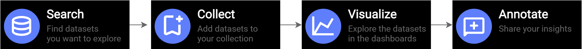
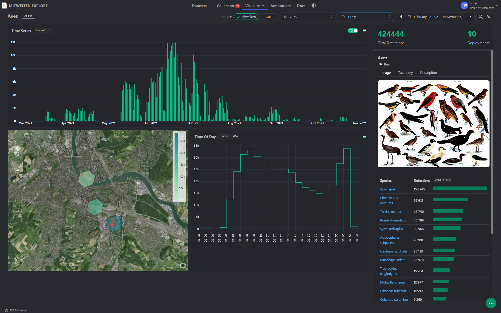
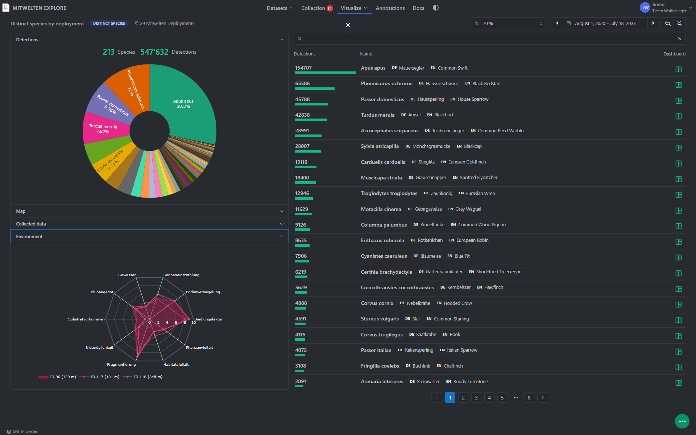
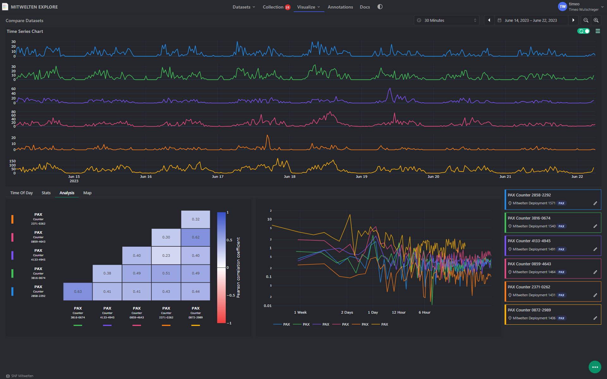
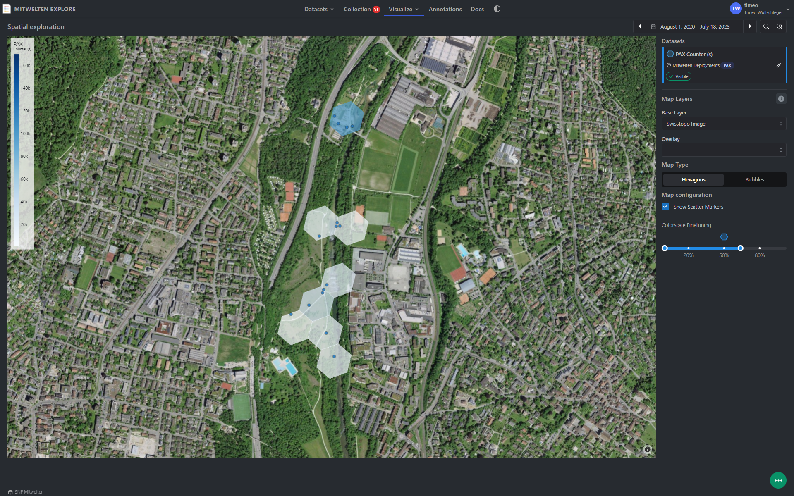
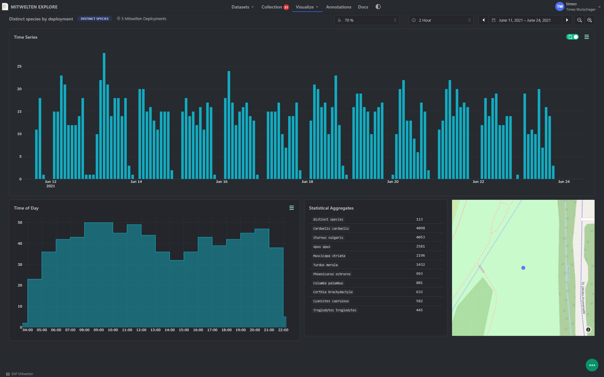

# Mitwelten Explore 
Visual Exploration for Urban Biodiversity Monitoring

**[explore.mitwelten.org](https://explore.mitwelten.org)**


Mitwelten Explore is an application for exploring biodiversity in and around Basel.

## Workflow



## Available Data Categories

- Taxon: Detections of a species, genus, order, family, class, phylum, or kingdom. This includes birds and pollinators.
- Pollinator: pollinators detected from the Mitwelten pollinator study.
- Bird Diversity: The number of distinct species observed at specific locations.
- Meteodata: Meteodata from MeteoSwiss.
- PAX: Values of the PAX sensors.
- ENV Measurements: Temperature, humidity and soil moisture recorded by the Environment Sensor Nodes.
- Taxon (GBIF): observations of a species, genus, order, family, class, phylum, or kingdom from external sources provided by GBIF.

## Dashboards

### Species Dashboard 🦅
Explore the spatial and temporal activity of more than 200 detected species


### Habitat-specific biodiversity 🌲
Discover the ontodiversity in specific places


### Compare different datasets 🔬
Find the factors that influence biodiversity


### Analyze spatial activities 🗺
Analyze spatial differences and find out where you could spot certain species


### Spot trends over time 📅
Learn about the seasonal and daily changes in biodiversity



## Setup

Requires Python 3.13.

```sh
cd mitwelten_explore
python3.13 -m venv .venv
source .venv/bin/activate
pip install -r requirements.txt
```

Configure Keycloak and the public URL in a file `.env` in the repository root (or as environment variables):

```conf
KC_SERVER_URL="https://auth.yourdomain.org/auth/"
KC_CLIENT_ID="client-id"
KC_REALM_NAME="realm"
DOMAIN_NAME="http://localhost:8081"
#REDIS_HOST="localhost" #optional
#REDIS_PORT=6379 #optional
```

The port in `DOMAIN_NAME` must be an allowed redirect URI (`<DOMAIN_NAME>/callback`) of the Keycloak client.

## Running

```sh
cd mitwelten_explore
source .venv/bin/activate
uvicorn main:app --port 8081 --reload   # http://localhost:8081/
```

## Dependency Upgrade Procedure

The image contains Python, the dependencies and the app code.

- [`requirements.in`](mitwelten_explore/requirements.in): direct dependencies, edit this file when installing new packages
- [`requirements.txt`](mitwelten_explore/requirements.txt): fully pinned lock file, generated from `requirements.in` (needs `uv`, see below)

1. Re-resolve all dependencies to their latest versions (for the Python version and platform of the image):

    ```sh
    cd mitwelten_explore
    uv pip compile requirements.in -o requirements.txt --python-version 3.13 --python-platform x86_64-manylinux_2_28 --upgrade
    ```

    To bump the Python version, change `FROM python:3.13-slim` in the [`Dockerfile`](mitwelten_explore/Dockerfile) and `--python-version` above.

    Dash Mantine Components requires a specific React version, which is set with `_set_react_version` in [`dashboard/app.py`](mitwelten_explore/dashboard/app.py).
    When it gets a major upgrade, check its [migration guide](https://www.dash-mantine-components.com/migration).

2. Test locally (see above): the home page, each dataset selection page, adding a dataset to the collection (notification),
   each dashboard type (time series, compare with all tabs, map with hexagons and bubbles, deployment, taxon), the docs,
   writing and editing an annotation, the dark theme and a mobile-sized window.

3. Build and scan the image (`--pull` gets the latest base image with its security fixes):

    ```sh
    cd mitwelten_explore
    docker build --pull --platform linux/amd64 -t mitwelten-explore:test .
    trivy image --severity HIGH,CRITICAL --ignore-unfixed mitwelten-explore:test
    ```

4. Tag and push the image to your registry
   (a registry that rejects build attestations needs `--provenance=false --sbom=false` in `docker build`):

    ```sh
    docker build --pull --platform linux/amd64 --provenance=false --sbom=false -t <registry>/mitwelten-explore:<major.minor> -t <registry>/mitwelten-explore:latest .
    docker push <registry>/mitwelten-explore:<major.minor>
    docker push <registry>/mitwelten-explore:latest
    ```

5. On the server, pull and recreate the `mitwelten-explore` container.

## Deployment

### Run the container
```sh
docker run --rm -d -p 8081:80 \
    --env KC_SERVER_URL=https://auth.yourdomain.org/auth/ \
    --env KC_CLIENT_ID=client-id \
    --env KC_REALM_NAME=realm \
    --env DOMAIN_NAME=http://localhost:8081 \
    <registry>/mitwelten-explore:latest
```
Add `--env REDIS_HOST=... --env REDIS_PORT=...` to cache data API requests in Redis.

Environment variables
name|required|description
-|-|-
KC_SERVER_URL|yes|Keycloak url
KC_CLIENT_ID|yes|Keycloak client id
KC_REALM_NAME|yes|Keycloak realm name
DOMAIN_NAME|yes|domain name for the `mitwelten-explore` app
REDIS_HOST|no|host of a redis instance for caching requests
REDIS_PORT|no|port of a redis database


### Run in docker compose

Minimal example
```yaml
version: '3.3'

services:
  mitwelten-explore:
    image: <registry>/mitwelten-explore:latest
    restart: always
    container_name: mitwelten-explore
    environment:
      - KC_SERVER_URL=https://auth.yourdomain.org/auth/
      - KC_CLIENT_ID=client-id
      - KC_REALM_NAME=realm
      - DOMAIN_NAME=https://explore.yourdomain.org
    labels:
      - "traefik.enable=true"
      - "traefik.http.services.mwexplore.loadbalancer.server.port=80"

      # for http
      - "traefik.http.routers.mwexplore_insecure.rule=Host(`explore.yourdomain.org`)"
      - "traefik.http.routers.mwexplore_insecure.entrypoints=http"

      # redirect to https
      - "traefik.http.middlewares.mwexplore-https.redirectscheme.scheme=https"
      - "traefik.http.routers.mwexplore_insecure.middlewares=mwexplore-https"

      # for https
      - "traefik.http.routers.mwexplore.rule=Host(`explore.yourdomain.org`)"
      - "traefik.http.routers.mwexplore.entrypoints=https"
      - "traefik.http.routers.mwexplore.tls.certresolver=ssl"
```

With redis, keycloak and traefik
```yaml
version: '3.3'

services:
  traefik:
    image: "traefik:v2.8.8"
    container_name: "traefik"
    command:
      - "--log.level=INFO"
      - "--api.insecure=true"
      - "--providers.docker=true"
      - "--providers.docker.exposedbydefault=false"
      - "--entrypoints.http.address=:80"
      - "--entrypoints.https.address=:443"
      - "--certificatesresolvers.ssl.acme.tlschallenge=true"
      - "--certificatesresolvers.ssl.acme.email=your-email@example.ch"
      - "--certificatesresolvers.ssl.acme.storage=/letsencrypt/acme.json"
      - "--providers.file.watch=true"
    ports:
      - "80:80"
      - "443:443"
    volumes:
      - "/etc/letsencrypt:/letsencrypt"
      - "/var/run/docker.sock:/var/run/docker.sock:ro"
    restart: always

  keycloak:
    container_name: keycloak
    image: quay.io/keycloak/keycloak:legacy
    restart: unless-stopped
    environment:
      KEYCLOAK_USER: ${KC_USERNAME}
      KEYCLOAK_PASSWORD: ${KC_PASSWORD}
      DB_VENDOR: POSTGRES
      DB_ADDR: ${KC_DB_HOST}
      DB_DATABASE: ${KC_DATABASE}
      DB_USER: ${KC_DB_USERNAME}
      DB_PASSWORD: ${KC_DB_PASSWORD}
      DB_SCHEMA: ${KC_DB_SCHEMA}
      PROXY_ADDRESS_FORWARDING: "true"
    labels:
      - "traefik.enable=true"
      - "traefik.http.services.kc.loadbalancer.server.port=8080"
      # for http
      - "traefik.http.routers.kc_insecure.rule=Host(`auth.yourdomain.org`)"
      - "traefik.http.routers.kc_insecure.entrypoints=http"

      # redirect to https
      - "traefik.http.middlewares.kc-https.redirectscheme.scheme=https"
      - "traefik.http.routers.kc_insecure.middlewares=kc-https"

      # for https
      - "traefik.http.routers.kc.rule=Host(`auth.yourdomain.org`)"
      - "traefik.http.routers.kc.entrypoints=https"
      - "traefik.http.routers.kc.tls.certresolver=ssl"

  mitwelten-explore:
    image: <registry>/mitwelten-explore:latest
    restart: always
    container_name: mitwelten-explore
    environment:
      - KC_SERVER_URL=https://auth.yourdomain.org/auth/
      - KC_CLIENT_ID=client-id
      - KC_REALM_NAME=realm
      - DOMAIN_NAME=https://explore.yourdomain.org
      - REDIS_HOST=redis_cache
      - REDIS_PORT=6379
    labels:
      - "traefik.enable=true"
      - "traefik.http.services.mwexplore.loadbalancer.server.port=80"

      # for http
      - "traefik.http.routers.mwexplore_insecure.rule=Host(`explore.yourdomain.org`)"
      - "traefik.http.routers.mwexplore_insecure.entrypoints=http"

      # redirect to https
      - "traefik.http.middlewares.mwexplore-https.redirectscheme.scheme=https"
      - "traefik.http.routers.mwexplore_insecure.middlewares=mwexplore-https"

      # for https
      - "traefik.http.routers.mwexplore.rule=Host(`explore.yourdomain.org`)"
      - "traefik.http.routers.mwexplore.entrypoints=https"
      - "traefik.http.routers.mwexplore.tls.certresolver=ssl"

  redis_cache:
    image: redis
    container_name: redis_cache
    restart: always
```
